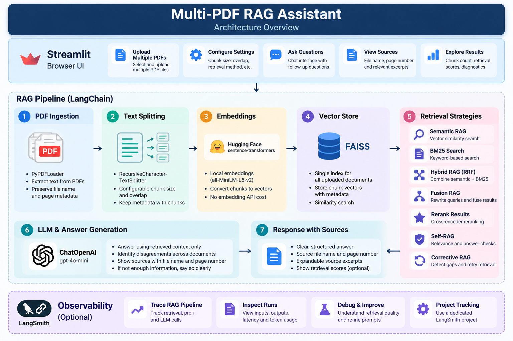

# MultiPDF RAG Assistant

A local document Q&A application that searches across multiple PDF documents, generates evidence-grounded answers, and lets you inspect the passages behind each response.

## Demo

Watch the application walkthrough:

<video src="assets/Document-Intelligence-RAG-Assistant.mp4" controls playsinline width="100%">Your browser does not support embedded video. [Open the demo video](assets/Document-Intelligence-RAG-Assistant.mp4).</video>

Save your screen recording as `screenshots/demo.mp4` for this embed to work. GitHub's rendering of repository-hosted video can vary by browser; if the player does not appear, use the [direct video link](screenshots/demo.mp4).

## Architecture



## Features

- Upload multiple PDFs together and index all documents in one shared FAISS vector store.
- Preserve source filename and page metadata through chunking and retrieval.
- Display source filename, page number, and retrieved excerpts for each answer.
- Use hybrid semantic and keyword retrieval to find relevant passages.
- Apply consistent internal chunking defaults for reliable document processing.
- Load the OpenAI API key from a local `.env` file; no API key is entered in the application interface.
- Show document, page, and chunk counts.
- Keep the index and chat in Streamlit session state.
- Use local Hugging Face embeddings and OpenAI for answer generation.
- Support LangSmith tracing through environment variables.
- Prompt for insufficient-evidence handling and source disagreement.

## How it works

1. **Ingest:** `PyPDFLoader` extracts page-level documents from each uploaded PDF.
2. **Split:** `RecursiveCharacterTextSplitter` creates overlapping chunks while retaining metadata.
3. **Embed and index:** `all-MiniLM-L6-v2` creates local embeddings; FAISS stores all chunks together.
4. **Retrieve:** use dense semantic search, BM25 keyword search, or hybrid RRF fusion.
5. **Generate:** `ChatOpenAI` answers from retrieved evidence and is instructed to cite filename and page.
6. **Inspect:** expand the evidence panel to examine the retrieved passages.

## Retrieval strategies

| Strategy | Description | Useful for |
|---|---|---|
| Dense semantic search | Finds semantically similar chunks | Paraphrases and conceptual questions |
| BM25 keyword search | Matches terms lexically | Exact terms, names, and identifiers |
| Hybrid fusion | Combines dense and BM25 rankings with RRF | Combining semantic and exact-term signals |

RRF scores are ranking signals, not probabilities. FAISS distance scores should not be interpreted as confidence values.

## Setup

### 1. Create and activate a virtual environment

```powershell
python -m venv .venv
.\.venv\Scripts\Activate.ps1
```

### 2. Install dependencies

```powershell
python -m pip install --upgrade pip
pip install -r requirements.txt
```

### 3. Configure your OpenAI API key

Create a `.env` file in the project root and add your own API key:

```env
OPENAI_API_KEY=your_openai_api_key
```

The application loads this value locally through `python-dotenv`. The key is not entered in the application interface. Keep `.env` private and ensure it is excluded by `.gitignore`; never commit or share your real API key. OpenAI API usage may incur charges to the account associated with the key.

Optional LangSmith tracing can also be configured through environment variables in the local `.env` file.

### 4. Run

```powershell
streamlit run rag_app.py
```

Streamlit will print the local browser URL, normally `http://localhost:8501`.

## Suggested evaluation

Try questions that exercise different retrieval behaviors:

- A direct question answered in one PDF.
- A question whose evidence appears in two PDFs.
- A paraphrased question that does not repeat the source wording.
- An exact term or identifier, comparing dense, BM25, and hybrid retrieval.
- A question the PDFs do not answer.
- A question where two documents disagree.

Check that the answer cites the correct source pages and does not silently resolve conflicting statements.

## Technology

Python · Streamlit · LangChain · PyPDF · Hugging Face Sentence Transformers · FAISS · BM25 · OpenAI · LangSmith

## Design notes and limitations

- Embeddings run locally; answer generation uses the OpenAI API and may incur charges.
- The first embedding-model use may download model files.
- Scanned/image-only PDFs require OCR; OCR is not included.
- Retrieval quality depends on source text and the relevance of retrieved passages.
- Conflicts are only surfaced when relevant conflicting evidence is retrieved and recognized by the model; this is not a formal contradiction detector.
- This project is intended to run locally. The OpenAI API key is read from the local `.env` file and is not displayed in the UI. Keep the file out of version control.

## Project structure

```text
multipdf-rag-assistant/
├── rag_app.py
├── requirements.txt
├── .env.example
├── .gitignore
├── README.md
├── assets/
│   └── architecture.png
├── sample_documents/
│   └── README.md
└── screenshots/
```

## Observability

When LangSmith tracing is enabled, inspect the `multipdf-rag-assistant` project for traced LangChain operations. Inputs, outputs, latency, and token usage depend on the integration and model metadata available for each run.
